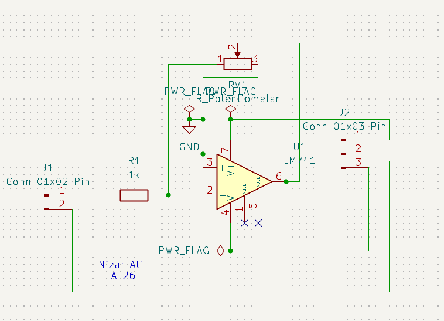
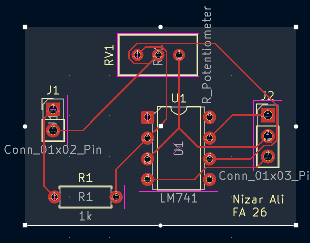
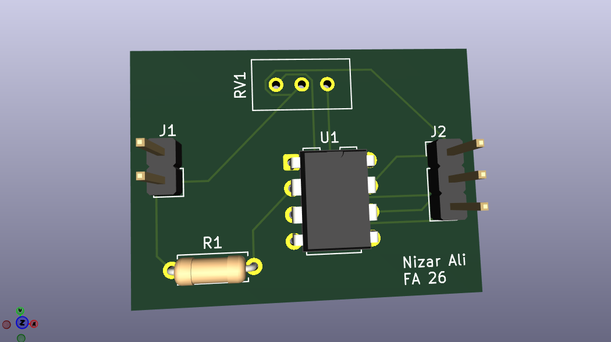

# Op-Amp

A two-part KiCad lab on operational-amplifier circuits built around the LM741. Each part goes from schematic to PCB layout to 3D render.

The LM741 is the op amp. These are circuits that *use* one, not op amps themselves.

- **Part 1:** an inverting amplifier with adjustable gain
- **Part 2:** the same idea with a capacitor added (in progress)

## Repository layout

```
kicad/
  part1-inverting-amplifier/   KiCad project for Part 1
  part2-capacitor/             KiCad project for Part 2 (in progress)
media/                         Screenshots used in this README
```

## Part 1: Inverting amplifier

### Schematic



| Ref | Part | Role |
|-----|------|------|
| U1 | LM741 (DIP-8) | Op amp |
| R1 | 1 kΩ | Input resistor (R<sub>in</sub>) |
| RV1 | Potentiometer | Variable feedback resistor (R<sub>f</sub>) |
| J1 | 1×2 pin header | Signal: pin 1 = input, pin 2 = output |
| J2 | 1×3 pin header | Power: pin 1 = V+, pin 2 = GND, pin 3 = V− |

### How it works

- The input goes through R1 into the **inverting (−) input** (pin 2). The **non-inverting (+) input** (pin 3) is tied to ground.
- RV1 sits between the output (pin 6) and the inverting input, so it sets the feedback resistance.
- Gain:

  **V<sub>out</sub> = −(R<sub>f</sub> / R<sub>in</sub>) · V<sub>in</sub> = −(R<sub>RV1</sub> / 1 kΩ) · V<sub>in</sub>**

  The output is inverted (180° out of phase). Turning RV1 sweeps the gain from 0 up to −R<sub>pot</sub>/1 kΩ.
- Offset-null pins 1 and 5 are left unconnected.

### PCB

| Layout | 3D view |
|--------|---------|
|  |  |

It's a single-sided, through-hole board.

### Usage

1. Connect a **dual (split) supply** to J2, for example ±12 V or ±15 V. The LM741 is not a single-supply or rail-to-rail part, so expect the output to clip about 1–2 V short of each rail.
2. Feed a signal into J1 pin 1, referenced to GND.
3. Measure the output on J1 pin 2 and adjust RV1 to set the gain.

### Notes

- The potentiometer's resistance isn't specified in the schematic. Choose it for the maximum gain you want: a 10 kΩ pot gives up to −10×.
- RV1's third leg is tied to GND. That puts part of the pot as a load from the output to ground. It works, but you could leave that leg floating or tie it to the wiper to use the pot as a plain rheostat.

## Part 2: Adding a capacitor (in progress)

Part 2 adds a capacitor to the circuit. A capacitor's impedance, Z<sub>C</sub> = 1 / (2πfC), falls as frequency rises, so the gain now depends on frequency. What the circuit does depends on where the capacitor goes:

| Capacitor placement | Circuit | Behaviour |
|---------------------|---------|-----------|
| In parallel with R<sub>f</sub> | Active low-pass filter | Gain is −R<sub>f</sub>/R<sub>in</sub> at low frequencies and rolls off above f<sub>c</sub> = 1 / (2πR<sub>f</sub>C) |
| Replacing R<sub>f</sub> | Integrator | V<sub>out</sub> = −(1 / R<sub>in</sub>C) ∫V<sub>in</sub> dt. A square wave in gives a triangle wave out. |
| In series with the input (in place of, or with, R<sub>in</sub>) | Differentiator / high-pass filter | V<sub>out</sub> = −R<sub>f</sub>C · dV<sub>in</sub>/dt. It blocks DC and passes fast edges. |

A pure integrator has unlimited gain at DC, so the 741's input offset will slowly drive the output into a rail. Putting a large resistor in parallel with the capacitor limits the DC gain and turns the integrator into the low-pass filter in the first row.

Schematic, layout and results will be added here once the design is finished.

## License

MIT. See [LICENSE](LICENSE).
